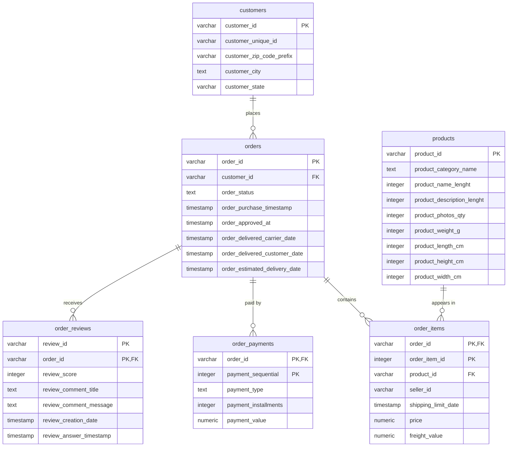

# Entity Relationship Diagram

Tables and relationships of `ecommerce_db`. PK = primary key, FK = foreign key.
The sellers and geolocation CSVs are not loaded in this project, so `seller_id` has no foreign key.

